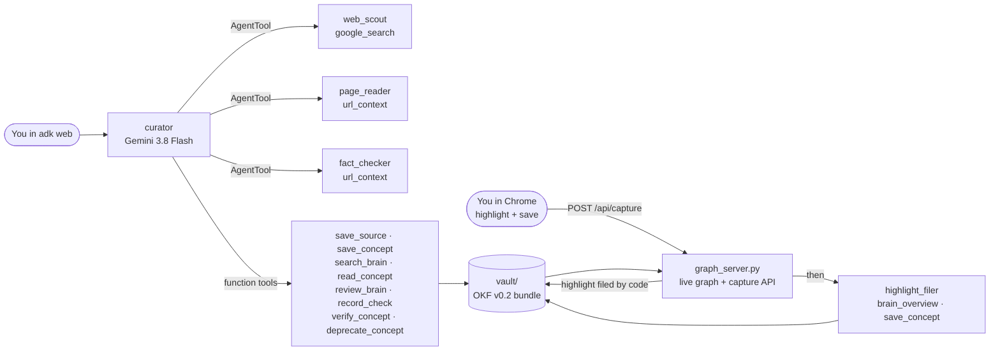

# Second Brain: Open Knowledge Format (OKF) meets Google Gemini

A second brain that fills itself in. You name a topic, paste a URL, or highlight a passage in Chrome. Gemini finds and reads the sources, writes a summary, tags it, files it as an [Open Knowledge Format](https://github.com/GoogleCloudPlatform/open-knowledge-format) v0.2 concept, and links it into a knowledge graph that redraws live while the agent works.

Built with the Agent Development Kit (ADK) 2.x and a Google AI Studio API key. Demo for the talk *Building an Intelligent Second Brain: Open Knowledge Format (OKF) Meets Google Gemini* (DevFest Kuala Lumpur 2026).

## What it shows

| You say | What happens | What you see in the graph |
|---|---|---|
| "Research Model Context Protocol and add it to my brain" | `web_scout` searches with Google Search grounding. The curator files each source, then writes one concept with a summary, key points, tags and links. | A dashed "gap" node turns into a solid amber node, wired to its sources, tags and related concepts. |
| Highlight a passage on any web page and click **Save highlight** in the Chrome extension | The highlight is filed word for word as a source. A restricted agent then writes one draft concept from it. | A new amber node appears, linked to its source diamond. |
| "Read https://ai.google.dev/gemini-api/docs/embeddings and add a note called Vector Embeddings" | `page_reader` reads the page with the Gemini URL context tool. Same filing pipeline. | The second gap fills in, with a source diamond. |
| "Which OKF field records when a concept last changed?" | The curator reads two conflicting notes, ignores the `deprecated` one, answers from the current one and cites it. | Nothing changes. That is the point. |
| "What should I learn next?" | `review_brain` reports gaps (linked but unwritten), stale notes, and thinly covered tags. | The dashed and red-ringed nodes are the to-do list. |
| "Fact-check the MCP note" | `fact_checker` re-reads the sources and checks every key point. A pass adds a machine `verified` entry. | Amber turns blue (machine-confirmed). |
| "I have reviewed it, verify it" | ADK asks you to confirm the tool call. Your review is recorded as `human:<you>` and the note becomes `stable`. | Blue turns green (human-reviewed). |

## Why OKF

The vault is a plain folder of markdown. Any editor, `git`, Obsidian, or another agent can read it. OKF v0.2 adds the part an agent-written knowledge base needs: every concept says where it came from, who wrote it, who confirmed it and when it goes stale, all in frontmatter.

```yaml
---
type: Concept
title: Model Context Protocol
description: An open protocol that standardises how AI applications connect models to external tools and data.
tags: [mcp, agents, open-standard, tools]
status: draft
generated: { by: second-brain/gemini-3.8-flash, at: 2026-11-14T03:10:00Z }
stale_after: 2027-03-14T03:10:00Z
sources:
  - id: model-context-protocol-documentation
    resource: /references/model-context-protocol-documentation.md
    title: Model Context Protocol documentation
---
```

The trust tier is not stored. It is derived from `verified`, exactly as the spec says: no entry is **unverified**, non-human actors only is **machine-confirmed**, a `human:` actor is **human-reviewed**.

## Architecture



Design choices worth pointing out on stage:

- **The model decides what to save. Code decides how it lands on disk.** `save_concept` sets `status: draft`, `generated`, `stale_after` and the `sources` block itself, normalises tags against the existing vocabulary, and rebuilds `index.md` and `log.md`. The frontmatter is valid OKF whatever the model does.
- **Linking is automatic.** A new concept is linked to what the model names, plus any concept that shares two or more tags or is mentioned by title. Tags and sources add more edges. Links to concepts that do not exist yet are kept: OKF allows broken links, and they become the "what to learn next" list.
- **Writing and confirming are different actors.** The agent never verifies its own work. A separate checker can make a note machine-confirmed. Only a human, through an ADK tool confirmation, makes it stable.
- **Human-reviewed notes are protected.** The agent cannot overwrite a fresh human-reviewed concept. It can rewrite one that is past its `stale_after`.

## Run it

Python 3.10 or newer and a [Google AI Studio API key](https://aistudio.google.com/apikey).

```bash
git clone https://github.com/kuanhoong/second-brain-agent && cd second-brain-agent
python -m venv .venv && source .venv/bin/activate      # Windows: .venv\Scripts\activate
pip install -r requirements.txt
cp .env.example .env            # paste your key into GOOGLE_API_KEY

python graph_server.py          # terminal 1: live graph at http://localhost:8765
adk web                         # terminal 2: open http://localhost:8000 and pick "second_brain"
```

Run both commands from the repo root. `adk web` finds the `.env` there by itself, and `graph_server.py` reads the same file, so the key is set once.

Put the two browser windows side by side: chat on the left, graph on the right. Press `f` in the graph to fit the view. `run_demo.md` has the stage runsheet with the five demo beats and fallbacks.

## Example brain: AI micro drama

`brains/ai-micro-drama/` is a second, larger OKF bundle on making AI micro dramas: 54 concepts and 63 source references across industry, writing, characters, prompting, cinematography, production and distribution, plus fill-in templates for character sheets, bibles, episode scripts, shot lists and video prompts. Start at `ai-micro-drama.md`.

```bash
VAULT_DIR=brains/ai-micro-drama python graph_server.py   # graph of this brain
VAULT_DIR=brains/ai-micro-drama adk web                  # ask the curator about it, or add to it
```

On Windows PowerShell, set it first with `$env:VAULT_DIR="brains/ai-micro-drama"`, or put `VAULT_DIR=` in `.env`. Both servers must point at the same bundle.

Every claim is footnoted to a source page. All 54 concepts were researched and written by an AI research agent in November 2026, so they are `status: draft` and unverified: read them, then ask the curator to verify the ones you trust. Notes on fast-moving topics (models, prices, platform rules) carry short `stale_after` dates on purpose. Two links point to notes not written yet (localization, image models for keyframes): `review_brain` lists them as what to research next.

In the graph, untick tags and sources to see the concepts alone.

## Chrome extension: capture what you highlight

`extension/` is a small Manifest V3 extension. Highlight text on any page, then use the toolbar button, the right-click item "Save highlight to Second Brain", or `Alt+Shift+S`.

1. Open `chrome://extensions`, turn on Developer mode, click **Load unpacked** and pick the `extension/` folder.
2. Keep `python graph_server.py` running. The extension posts to `http://127.0.0.1:8765/api/capture`.
3. Highlight, save, and watch the node appear in the graph.

How a capture is handled:

- **Code first.** The highlight is written verbatim into a Reference concept before any model runs. With no key or no network you still keep the passage, and the popup tells you it was saved but not summarised.
- **Then Gemini.** `highlight_filer` writes one draft concept from the passage. It has two tools only, `brain_overview` and `save_concept`: no web access, no verify, no deprecate. Text from a web page is untrusted input, so the agent that reads it can do very little.
- **Locked down.** The server listens on 127.0.0.1 and accepts captures only from a `chrome-extension://` origin, so an ordinary web page cannot post into your brain.
- **Works where URL reading cannot.** The text comes from your browser, so logged-in and paywalled pages work. It is also sent to the Gemini API, so do not highlight anything confidential.

## Other commands

```bash
python scripts/validate.py                                 # OKF v0.2 conformance check
python scripts/offline_capture.py model-context-protocol   # canned capture, no network or key
python graph_server.py --export viz.html                   # self-contained offline graph
pip install -r requirements-dev.txt && pytest -q           # offline tests, no API key
./reset.sh                                                 # restore vault/ to the committed seed state
```

`reset.sh` uses git, so it works in a clone of this repo. It resets `vault/` only, not `brains/`.

## Layout

```
second_brain/        ADK app
  agent.py           curator + web_scout, page_reader, fact_checker, highlight_filer
  capture.py         highlight capture for the Chrome extension
  tools.py           function tools over the vault
  okf.py             OKF v0.2: parse, write, index, log, validate, graph
  config.py          model ID and owner id
vault/               the OKF bundle for the talk demo (9 concepts, 2 references)
brains/ai-micro-drama/  a larger example bundle (54 concepts, 63 references)
extension/           Chrome extension: save the highlighted text
viewer/index.html    dependency-free canvas graph (no CDN, works offline)
graph_server.py      serves the viewer, /api/graph and /api/capture
demo_backup/         canned captures for the offline fallback
scripts/             validate.py, offline_capture.py
tests/               offline tests for the OKF layer and the tools
run_demo.md          stage runsheet
```

## Honest notes

- The seed vault was written by hand for the demo. Its frontmatter is set so the graph starts with every state visible: human-reviewed, machine-confirmed, deprecated, stale, and two gaps.
- Agent output is not deterministic. Rehearse with the exact model ID you will use on stage and keep `demo_backup/` ready.
- Model IDs and ADK APIs move fast. This was written against `google-adk` 2.14 and `gemini-3.8-flash` in November 2026. Check both before you rely on them.
- Search and URL reads count against your AI Studio quota.
- OKF is at v0.2 and still changing. `superseded_by` is this demo's own extension key, which the spec permits.
- The extension is loaded unpacked for the demo; it is not in the Chrome Web Store.

## Earlier version

The first version of this demo (the "archivist" agent that tidied an inbox into an OKF v0.1 vault) is in the git history at commit `672b033`.

MIT licensed.
