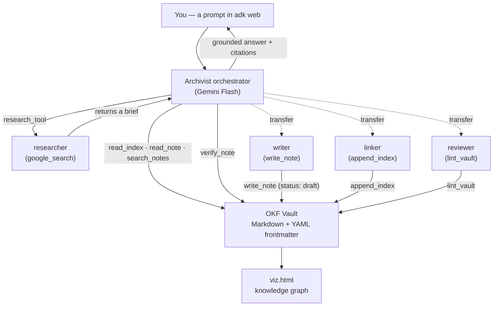
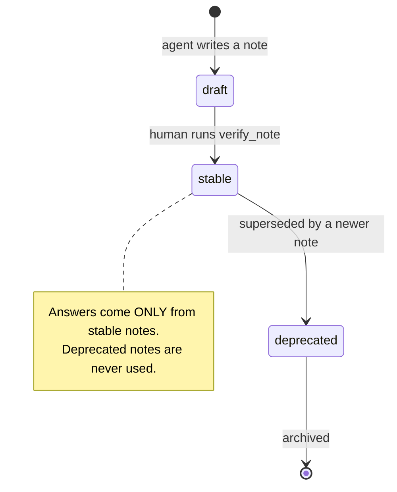
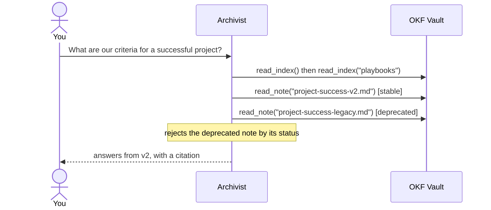

# 🧠 Agentic Second Brain — OKF × Gemini × ADK

A working demo of a **self-maintaining second brain**. Your notes live as an [Open Knowledge Format](https://cloud.google.com/blog/products/data-analytics/how-the-open-knowledge-format-can-improve-data-sharing) (OKF) vault of plain Markdown, and a **multi-agent system** built on Google's [Agent Development Kit](https://adk.dev/) (ADK), powered by **Gemini**, reads it, answers from it, writes new notes, and keeps it healthy.

> **The idea in one line:** RAG *reads* your notes. This agent *keeps* them. Because every note carries OKF trust signals (`status: stable | draft | deprecated`), the agent's answers are deterministic and contradiction free.

Built for a talk on building an intelligent second brain with Obsidian and Gemini.

---

## How it works

A root **Archivist** agent (Gemini Flash) answers questions from the vault and delegates the work of maintaining it to four specialists. It follows two rules baked into its instruction: read an index before opening notes (progressive disclosure), and answer only from `stable` notes.



The search agent is wrapped as an **AgentTool** rather than a transfer sub-agent, because Gemini does not allow a built-in tool (`google_search`) and function calling in the same request. As an AgentTool it runs isolated, so real web search works.

### Trust signals

Every note has a `status`. The whole point of the demo is that the agent reasons about it.



### The signature moment (Contradiction-Killer)

The vault ships with two conflicting playbooks, one `stable` and one `deprecated`. Ask the agent a question they both answer, and it does not average them. It reads the frontmatter and picks the trusted one.



---

## Repository layout

```
second-brain-agent/
├── my-second-brain/        # the OKF vault (dev-learning notes)
│   ├── index.md · log.md
│   ├── concepts/  playbooks/  references/  00_inbox/
│   └── every note = Markdown + YAML frontmatter trust signals
├── archivist/              # the multi-agent ADK app
│   ├── agent.py            # root orchestrator (root_agent)
│   ├── sub_agents.py       # researcher (AgentTool) + writer + linker + reviewer
│   ├── tools.py            # FunctionTools over the vault
│   └── okf.py              # OKF parse / write / graph helpers
├── build_viz.py            # generates an offline, colour-coded graph (viz.html)
├── run_demo.md             # the demo runsheet (prompts + fallbacks)
├── reset.sh                # restore the vault from git between runs
├── demo_backup/            # canned fallback note for the research beat
├── requirements.txt · .env.example · .gitignore · LICENSE
```

## Quickstart

Requires Python 3.10+ and a free [Google AI Studio](https://aistudio.google.com/apikey) key.

```bash
pip install -r requirements.txt
cp .env.example .env          # paste your GOOGLE_API_KEY
python build_viz.py           # generate viz.html, open it in a browser
adk web                       # dev UI → select the "archivist" agent
```

Your key lives only in `.env`, which is gitignored and never committed.

## Run the demo

Select the **archivist** agent in `adk web`, keep `viz.html` open beside it, and run these four prompts in order. Full runsheet with fallbacks is in [`run_demo.md`](run_demo.md).

1. **Compile** — `Read 00_inbox/dump.md, compile it into a proper OKF concept note under concepts/, give it valid frontmatter, and link it into the concepts index.` A messy note becomes a clean, linked `draft` note (a new amber node in the graph).
2. **Contradiction-Killer** — `What are our criteria for a successful project?` The agent opens both playbooks, rejects the `deprecated` one, and answers from the `stable` one.
3. **Multi-agent research** — `Research the current impact of AI Overviews on click-through, and add it to my brain.` researcher → writer → linker → reviewer.
4. **Maintain and verify** — `Anything in my brain rotting or contradictory?` then `Verify concepts/<the draft note>.` The reviewer flags the stale and deprecated notes; verifying flips the draft node amber → green.

The graph does not auto-refresh: after any beat that writes a note, re-run `python build_viz.py` and reload `viz.html`. Between runs, `./reset.sh` restores the vault from git.

## The graph (`viz.html`)

A fully offline, dependency-free force-directed graph. Nodes are coloured by trust signal: **green** stable, **amber** draft, **grey** deprecated, **blue** index; a **pink ring** marks notes past their `stale_after` date. Every agent action changes the picture.

## Caveats

- **OKF** is an early open spec. The `status / verified / stale_after` trust-signal fields here are a spec-compatible convention (OKF only requires `type`). Verify the current spec before relying on it.
- **ADK** APIs and Gemini model ids move quickly. This targets `google-adk` with `adk web`; pin an exact model id and re-test before relying on it. Some ADK versions require `google_search` to be the only tool on its agent, which is why the search agent is wrapped as an `AgentTool`.
- Agents are non-deterministic. The pre-seeded vault plus `./reset.sh` keep the demo reproducible.
- `google_search` and Gemini calls consume Google AI Studio free-tier limits.

## License

MIT. See [LICENSE](LICENSE).
